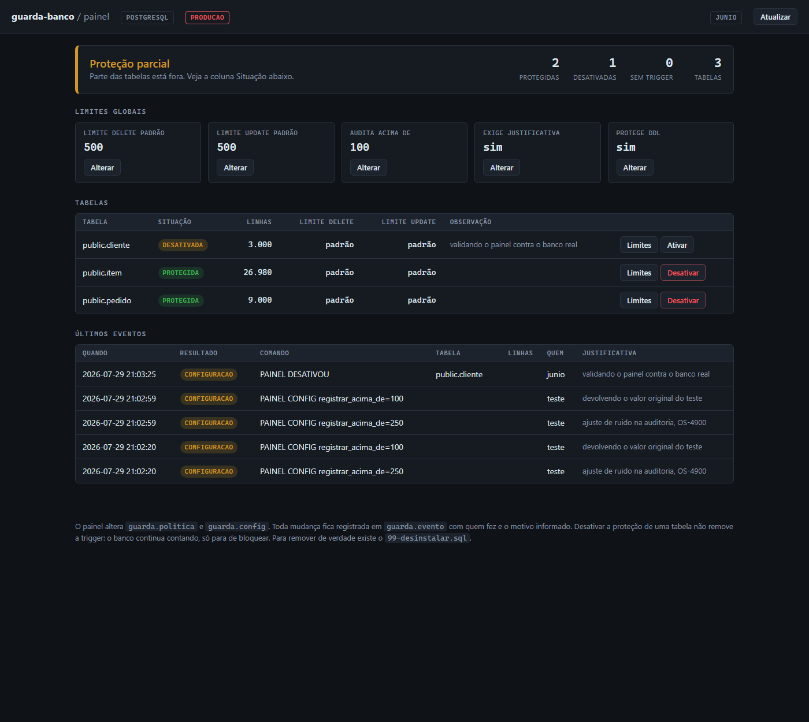
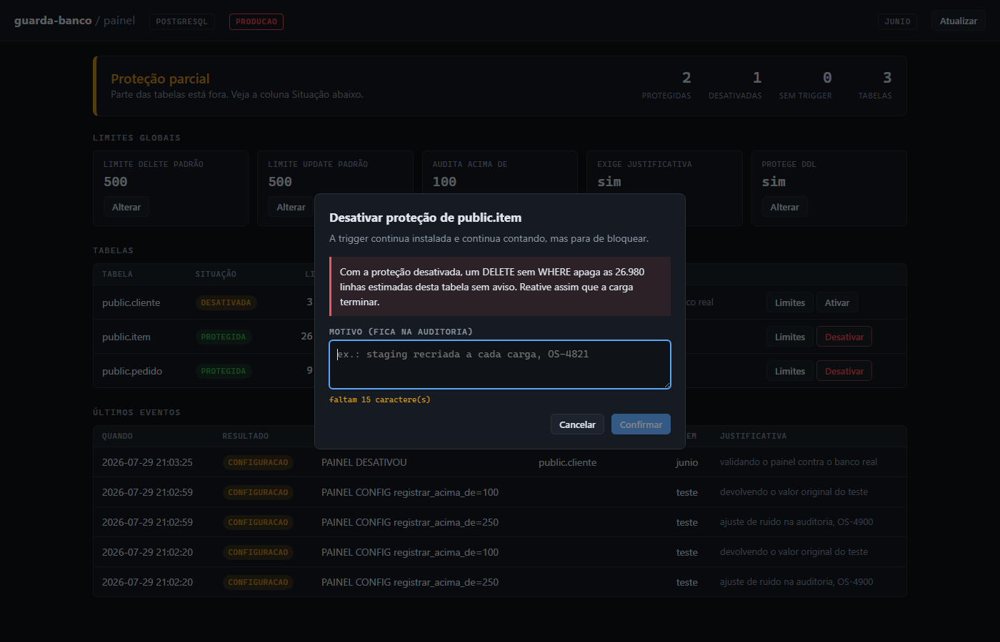

# guarda-banco

Proteção contra `DELETE` e `UPDATE` acidentais dentro do servidor de banco.

A proteção fica no banco, não no cliente. Isso é o ponto: se cada pessoa
usa DBeaver, Workbench, SSMS, psql, script Python ou o que preferir, não
existe configuração de cliente que dê conta. Trigger no servidor vale para
todos, inclusive para o script que alguém rodou do notebook às 19h de uma
sexta.

## O que ele realmente faz

O núcleo não é detectar `DELETE` sem `WHERE`. Isso é o caso fácil, e a
maioria dos clientes gráficos já avisa.

O que destrói dados em empresa é o `WHERE` que a pessoa achou que
filtrava 3 linhas e filtrava 400 mil. Então o guard mede **quantas linhas
o comando vai afetar** e aborta acima de um limite. Uma regra só cobre
`DELETE` sem `WHERE`, `UPDATE` sem `WHERE`, `WHERE` amplo demais, `OR` no
lugar de `AND`, filtro de data errado, cascata inesperada e mais uns
quantos. O catálogo completo está em [docs/catalogo-incidentes.md](docs/catalogo-incidentes.md).

Quando o comando é intencional mesmo, você declara:

```sql
BEGIN;
SELECT guarda.liberar('expurgo de logs anteriores a 2023, OS-4821');
DELETE FROM log_acesso WHERE criado_em < '2023-01-01';
-- olha o número de linhas
COMMIT;
```

A liberação vale só naquela transação (ou por 60 segundos, no SQL Server e
no MySQL). Com autocommit ligado ela morre antes do comando chegar, o que
força o hábito que mais evita perda de dados: rodar dentro de transação e
olhar o resultado antes de confirmar.

## Camadas

| Camada | O que pega | Onde fica |
|--------|-----------|-----------|
| Limite de linhas | volume: `DELETE`/`UPDATE` grande demais | trigger no servidor |
| `TRUNCATE` | limpeza de tabela inteira | trigger (PostgreSQL) ou privilégio |
| DDL | `DROP TABLE`, `DROP COLUMN`, `DROP SCHEMA` | event trigger / DDL trigger / privilégio |
| Antissabotagem | remover ou desativar o próprio guard | event trigger / DDL trigger |
| Auditoria | quem fez, de onde, com que justificativa | tabela `guarda.evento` |
| Privilégio | tudo que trigger não alcança | `GRANT`/`REVOKE`/`DENY` |
| Linter | `= NULL`, `OR` sem parênteses, junção faltando | hook de pre-commit |
| Painel | ver a situação, ligar e desligar com motivo obrigatório | tela local |

## Cobertura por engine

Nem tudo dá em todo banco. O que muda:

|  | PostgreSQL | SQL Server | MySQL |
|--|-----------|-----------|-------|
| Limite de linhas | sim, aborta antes de apagar | sim, aborta depois e desfaz | sim, depende do performance_schema |
| Cascata de FK entra na conta | sim | sim | **não**, MySQL não dispara trigger em cascata |
| `TRUNCATE` | trigger própria | só privilégio | só privilégio |
| DDL destrutivo | event trigger | DDL trigger | só privilégio |
| Tabela nova adotada sozinha | sim | sim | não, rode o gerador |
| Bloqueio fica auditado | log do servidor | tabela | não, precisa de plugin |

O PostgreSQL é o mais completo dos três, por causa dos event triggers e
das triggers de statement. O MySQL é o mais limitado, e vale ler
[docs/limitacoes.md](docs/limitacoes.md) antes de prometer proteção para a
equipe.

Sobre o que já rodou: a parte de PostgreSQL foi executada de ponta a ponta
em PostgreSQL 18, com os 17 casos do teste de aceitação passando, mais o
painel contra o mesmo banco. MySQL e SQL Server estão escritos e revisados,
e o MySQL roda na CI. **A parte de SQL Server ainda não foi executada em um
servidor de verdade**: rode o `sqlserver/90-teste-aceitacao.sql` em
homologação antes de usar.

## Instalação

**Rode primeiro em homologação, com o teste de aceitação.** Cada pasta tem
um `90-teste-aceitacao.sql` que cria um esquema próprio, tenta uns quinze
acidentes clássicos e diz o que passou.

### PostgreSQL 10+

```bash
psql -h host -U postgres -d seu_banco -f postgresql/01-base.sql
psql -h host -U postgres -d seu_banco -f postgresql/02-guardas-dml.sql
psql -h host -U postgres -d seu_banco -f postgresql/03-guardas-ddl.sql
psql -h host -U postgres -d seu_banco -f postgresql/04-instalador.sql

# leia antes, este arquivo é receita e mexe em papéis
psql -h host -U postgres -d seu_banco -f postgresql/05-papeis.sql

# proteger as tabelas
psql -h host -U postgres -d seu_banco -c "SELECT * FROM guarda.instalar_esquema('public')"

# conferir
psql -h host -U postgres -d seu_banco -c "SELECT * FROM guarda.sem_protecao"
```

Precisa de superusuário: event trigger só pode ser criado por superusuário.

### SQL Server 2016+

```
sqlcmd -S servidor -d seu_banco -i sqlserver\01-base.sql
sqlcmd -S servidor -d seu_banco -i sqlserver\02-instalador.sql
sqlcmd -S servidor -d seu_banco -i sqlserver\03-guardas-ddl.sql
sqlcmd -S servidor -d seu_banco -i sqlserver\04-permissoes.sql

sqlcmd -S servidor -d seu_banco -Q "EXEC guarda.instalar_banco"
sqlcmd -S servidor -d seu_banco -Q "SELECT * FROM guarda.sem_protecao"
```

### MySQL 8.0 / MariaDB 10.5+

Use o cliente `mysql` ou uma ferramenta que respeite `DELIMITER`.

```bash
mysql -h host -u root -p < mysql/01-base.sql
mysql -h host -u root -p < mysql/02-servidor.sql      # roda o diagnóstico no fim
mysql -h host -u root -p < mysql/03-gerador-triggers.sql

# leia antes, mexe em privilégios
mysql -h host -u root -p < mysql/04-privilegios.sql

# o MySQL não aceita CREATE TRIGGER em SQL dinâmico, então o gerador
# devolve as instruções e você executa
mysql -N -B -e "CALL guarda.gerar('seu_banco')" | mysql
mysql -e "SELECT * FROM guarda.sem_protecao"
```

Confira o diagnóstico antes de considerar instalado:

```sql
CALL guarda.diagnostico();
```

## Painel

Tela para ver a situação e ligar ou desligar a proteção sem precisar
escrever SQL.



```bash
pip install "psycopg[binary]"      # ou PyMySQL, ou pyodbc

# aponta para o banco
export GUARDA_DSN="host=servidor port=5432 dbname=loja user=postgres"
python painel/servidor.py --engine postgresql

# para só olhar, sem risco de mexer
python painel/servidor.py --engine postgresql --somente-leitura

# para ver a cara dele sem banco nenhum
python painel/servidor.py --engine demo
```

Abre em <http://127.0.0.1:8777>.

O que ele faz:

- mostra se a proteção está inteira, parcial ou desligada, e quantas tabelas
  estão em cada situação
- lista as tabelas com o limite de cada uma e o número de linhas
- liga e desliga a proteção por tabela, e ajusta limites
- mostra os últimos eventos, inclusive as tentativas bloqueadas

Três decisões de desenho, porque a tela é justamente o ponto onde alguém
pode desligar a proteção com um clique:

**Motivo obrigatório.** Nada é alterado sem uma justificativa de pelo menos
15 caracteres, e ela vai para `guarda.evento` junto com o usuário do
sistema operacional. A mesma regra do `guarda.liberar()` no banco.



**A confirmação mostra o tamanho do estrago.** Antes de desativar, a tela
diz quantas linhas aquela tabela tem, para a decisão não ser abstrata.

**Escuta só em 127.0.0.1.** O painel não tem senha, então não é coisa para
ficar aberta na rede. Se precisar de acesso remoto, use túnel SSH em vez de
`--host 0.0.0.0`. Rodar com `--somente-leitura` é a forma segura de deixar o
time todo olhar.

Desativar pelo painel **não remove a trigger**. O banco continua contando e
auditando, só para de bloquear. Para remover de verdade existe o
`99-desinstalar.sql`.

### Linter (opcional, para migrações versionadas)

```bash
python lint/guarda_lint.py migracoes/

# no repositório do projeto
cp lint/pre-commit .git/hooks/pre-commit
chmod +x .git/hooks/pre-commit
```

Só precisa de Python 3.10 ou superior, nada de dependência externa. No
console do Windows, `chcp 65001` deixa os acentos legíveis.

## Testes

```bash
# tudo que não precisa de banco
python ferramentas/testar.py

# com banco, roda também a integração do painel
export GUARDA_DSN="host=127.0.0.1 port=5432 dbname=lojateste user=postgres"
python ferramentas/testar.py
```

Para validar o SQL sem tocar em banco nenhum da empresa, existe um script
que sobe um PostgreSQL descartável, instala o guarda, roda o teste de
aceitação e derruba tudo no fim:

```powershell
.\ferramentas\postgres-local.ps1
.\ferramentas\postgres-local.ps1 -Manter    # deixa no ar para usar o painel
```

Precisa dos binários do PostgreSQL (`scoop install postgresql`).

O que está coberto hoje:

| Suíte | Testes | Precisa de banco |
|-------|--------|------------------|
| Linter | 40 | não |
| Painel, HTTP e validações | 35 | não |
| Painel, integração | 8 | sim |
| Aceitação PostgreSQL, dentro do banco | 17 casos | sim |
| Aceitação SQL Server, dentro do banco | 16 casos | sim, não executado ainda |
| Aceitação MySQL, dentro do banco | 11 casos | sim, roda na CI |

O teste de integração do painel é o que fecha o ciclo: desativa pela API,
confirma que o `DELETE` grande passa a ser aceito pelo banco, reativa e
confirma que volta a bloquear. É a única forma de provar que o botão da
tela mexe na proteção de verdade.

A CI ([.github/workflows/testes.yml](.github/workflows/testes.yml)) roda
tudo isso em PostgreSQL 14, 16 e 18 e em MySQL 8.4.

## Ajuste

Limite global:

```sql
UPDATE guarda.config SET valor = '1000' WHERE chave = 'limite_delete_padrao';
```

Limite por tabela, que é o ajuste que você vai usar de verdade:

```sql
INSERT INTO guarda.politica (esquema, tabela, limite_delete, limite_update, observacao)
VALUES ('public', 'log_acesso', 10000, 500, 'tabela de log, expurgo diario em lotes');
```

Desligar em uma tabela, de propósito e com rastro:

```sql
INSERT INTO guarda.politica (esquema, tabela, ativo, observacao)
VALUES ('public', 'staging_importacao', false, 'staging recriada a cada carga, OS-4821');
```

## Antes de anunciar para a equipe

Três coisas que decidem se isso vai funcionar ou virar piada interna:

1. **Rodar o teste de aceitação em homologação.** Não confie no README,
   confie na saída do teste no seu ambiente.
2. **Medir o custo.** A trigger roda por linha afetada. Meça um `DELETE`
   típico antes e depois. Se o seu ETL noturno apaga milhões de linhas,
   trate essas tabelas na política antes de ligar em produção.
3. **Combinar a válvula de escape.** Se as pessoas não souberem como
   liberar quando é legítimo, em uma semana alguém pede para desligar tudo.
   [docs/operacao.md](docs/operacao.md) serve para colar no canal do time.

## Estrutura

```
docs/
  catalogo-incidentes.md   os 27 erros levantados e onde cada um é pego
  operacao.md              runbook: liberar, investigar, ajustar, rotina semanal
  limitacoes.md            o que não pega e quem passa por cima
postgresql/                01 a 05, teste de aceitação, desinstalação
sqlserver/                 01 a 04, teste de aceitação, desinstalação
mysql/                     01 a 04, teste, desinstalação, regras de ProxySQL
painel/                    servidor.py, index.html, repositorio.py, testes
lint/                      guarda_lint.py, testes, hook de pre-commit
ferramentas/               testar.py, postgres-local.ps1
```

## O que isto não é

Não é substituto de backup com PITR e restauração testada. Não protege
contra quem tem privilégio de superusuário e quer mesmo apagar. Não pega
erro que afeta poucas linhas, mas as erradas. Serve para uma coisa
específica: transformar "apaguei a tabela inteira" em uma mensagem de erro
e um susto de dez segundos.
